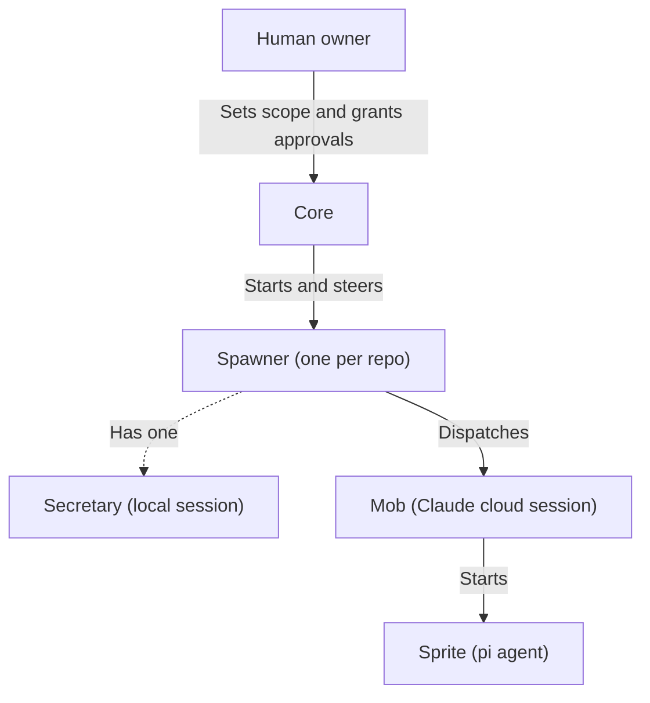
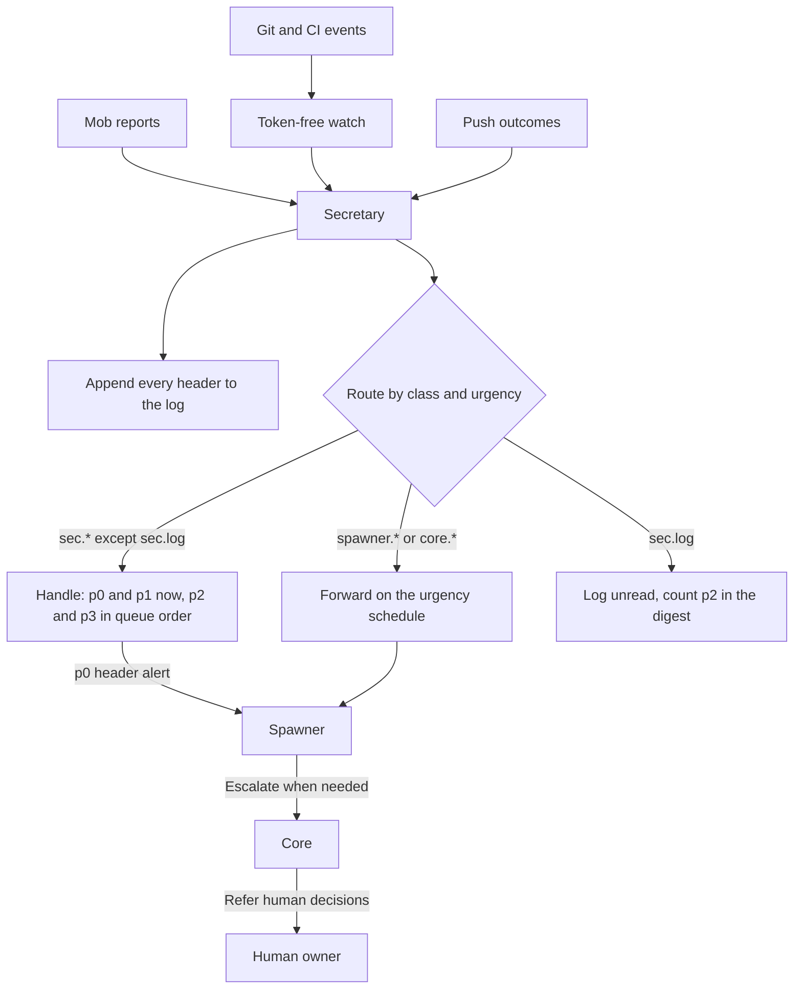
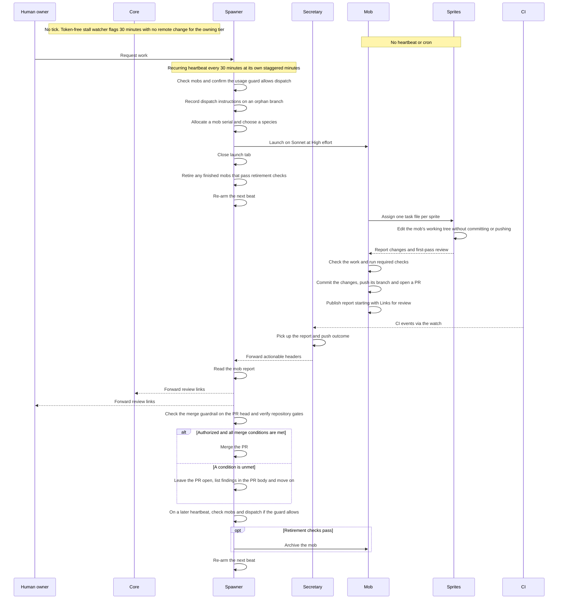
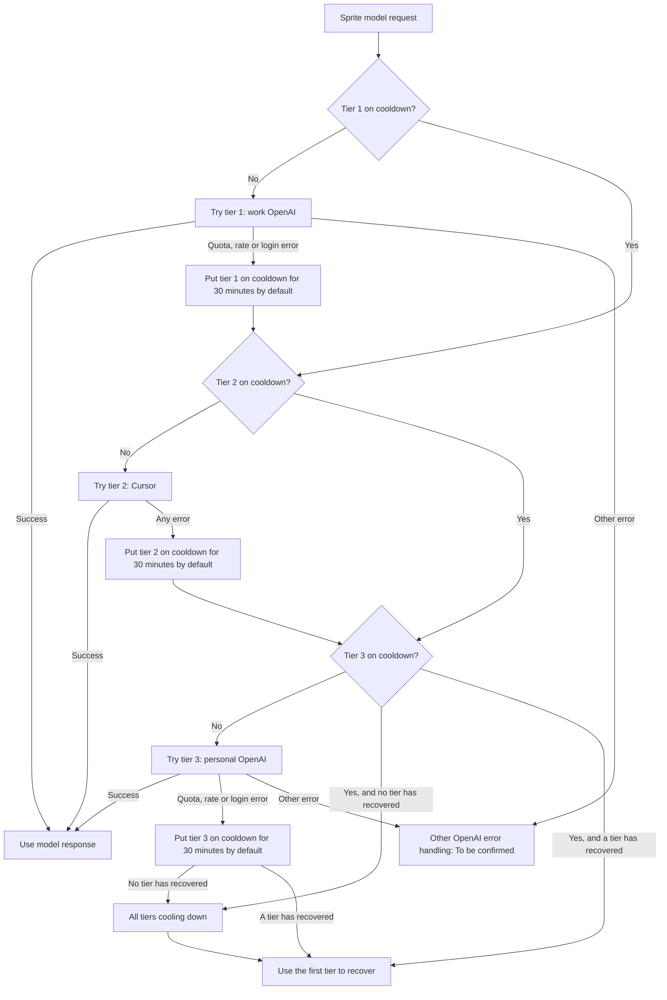

# Swarm architecture

This guide describes the swarm stack—core, spawners, secretaries, mobs and
sprites—for a design team building a frontend. It brings together conventions
approved by the user. The board records relationships and messages; it does
not launch workers or grant approvals.

**Contents**

1. [Tiers and authority](#1-tiers-and-authority)
2. [Naming](#2-naming)
3. [Messaging](#3-messaging)
4. [Lifecycles](#4-lifecycles)
5. [The model router](#5-the-model-router)
6. [Per-repo specifics and human gates](#6-per-repo-specifics-and-human-gates)
7. [Open questions](#7-open-questions)

## 1. Tiers and authority

Core steers spawners, spawners dispatch cloud mobs, and mobs delegate
implementation and first-pass review to pi sprites. Each spawner has one
secretary, a session convention rather than a tier or functional role. The
board does not launch workers, integrate code, push changes or grant approvals.

### Tier hierarchy



The dashed line shows the secretary relationship, not a launch step.
Who starts the core and secretary sessions: [To be confirmed](#7-open-questions).

| Tier | Work | Target share of work |
| --- | --- | --- |
| Core | Coordinates spawners, decides cross-repo questions and escalates to the user. | 0.5% |
| Spawner | Turns requests into dispatch briefs, reads mob reports and forwards review links to core and the user. | 4.5% |
| Mob | Keeps its own processing to a minimum: plans the work from a dispatch brief, starts sprites, checks their work, runs verification and reports. Does not write code. | 15% |
| Sprite | Runs in the mob's VM and implements or does first-pass review for one task. Creates no workers. | 75% |

The targets add to 95%, and no separate share is specified for secretaries.
How to account for the remaining 5%: [To be confirmed](#7-open-questions).

### Commit, push and merge authority

This table covers work branches, status branches, dispatch refs and pull
requests (PRs). “Merge” means merging a PR, not bringing the base branch into
a work branch. A mob class sets a ceiling on remote actions; it does not grant
local commit authority. The assignment, repository rules and harness limits
still apply.

| Actor | Commit | Push | Merge a PR | Other limits |
| --- | --- | --- | --- | --- |
| Core | To be confirmed | To be confirmed | To be confirmed | Does not write code. |
| Spawner | In the [watcher workflow](remote-watcher.md#spawner-commands), uses a private index to commit dispatch instructions and control records on `ty/board` (which shares no history with the base branch) and inbox messages on `ty/in/<task>`; commit authority on other branches: To be confirmed | Fast-forward pushes to those refs; push authority on other branches: To be confirmed | Only when authorized and the [merge guardrail](#merge-guardrail) and repository gates pass | Does not code or deep-review. |
| Secretary | Applies authorized mob patches; its own commit authority when applying them: To be confirmed | Plain push on request, after the repo's quick check | No | Does not write code or grant approvals. |
| Passive mob | To be confirmed | Never, including status pushes | No | Reads, runs checks and reports without pushing. |
| Neutral mob | Commits sprite changes in its working tree. In the watcher workflow, also commits its own status updates. | Own work branch; in the watcher workflow, pushes it at each checkpoint and also pushes its own [status branch](remote-watcher.md#refs), `<prefix>ty/<task>` | No | May open PRs where the harness allows; may not close PRs or delete branches. |
| Hostile mob | To be confirmed | Work- and status-branch push authority: To be confirmed | No | May close PRs or delete branches only with a clean gate and repository authorization, where the harness allows. |
| Boss mob | To be confirmed | To be confirmed | No | Swarm-wide operations only, each with the user's explicit OK. |
| Sprite | No | No | No | Writes code in the mob's working tree or does first-pass review; the mob checks the work. |

What constitutes a clean gate for Hostile close or delete actions:
[To be confirmed](#7-open-questions).

Use the approved pseudonymous commit identity and run the
[privacy checks](../SECURITY.md) before every commit and push. Never use
`--no-verify` or `--admin`. Do not rebase or force-push; merge the base branch
into the work branch instead. Do not add Claude-authored trailers. Never print
or commit credentials.

### Merge guardrail

An authorized spawner may merge only when CI is green on the exact PR head
and the latest review covers that same head with no findings above minor.
A mob-checked sprite review must cover that head and does not replace any
required independent review. All repository gates, including human gates,
still apply.

If any condition is unmet, leave the PR open, list the findings in the PR
body and move on. Never merge to end a review loop. A PR may stay in review
indefinitely.

### Tiers and functional roles

Tiers describe who creates and supervises whom; the eight functional roles
describe assigned duties. Use the
[tier-to-role mapping](taxonomy.md#how-the-tiers-map-to-the-roles). Neither a
tier label nor the secretary convention adds a functional role.

## 2. Naming

Names are display labels, not grants of authority. A mob's class limits its
remote actions, its species describes its job, and a sprite's item describes
its task. Spawners and secretaries use separate name pools. Labels may appear
in titles, dispatch briefs, reports and message metadata without changing
existing branch or status-ref formats.

### Titles

| Where | Format |
| --- | --- |
| Spawner sidebar title | `<TAG> <NAME>` |
| Secretary title | `<TAG> <Name>` |
| Mob session title | `<tag> <serial>-<SPECIES><n>`; add `<n>` only when every species in the job's list has a live mob (e.g. mob ID `120-COW2`). |
| Sprite name | `<mob-id>.<ITEM><n>`; add `<n>` only when the same mob runs more than one sprite with that item (e.g. item `PICKAXE2`). |

The tag is the repo tag. The mob ID in a sprite name is the serial and
species, including any species number, without the tag. Spawners and
secretaries keep their names for life; do not reuse a name while a session
with that name is alive.

### Mob classes and species

The [class table](swarm-naming.md#class-what-the-mob-may-do-on-the-remote)
sets ceilings, not permissions. The board does not enforce class limits, and
no class can override the repository's roles, assignments or harness
restrictions.

| Class | Remote ceiling in the naming convention | Limit |
| --- | --- | --- |
| Passive | Read, run checks, report | Never pushes anything. |
| Neutral | Push branches, open PRs | Does not merge or close PRs or delete branches. |
| Hostile | Merge or close PRs, delete branches | Mobs never merge PRs. Closing PRs or deleting branches requires a clean gate and repository authorization, where the harness allows. |
| Boss | Swarm-wide operations | Each operation requires the user's explicit OK. |

A mob that needs to push status is Neutral, not Passive. If a job requires
more than the mob's class allows, rename the mob rather than stretching the
class.

Pick the job, then take the first species in its
[ordered list](swarm-naming.md#mobs) below with no live mob. Species names
have at most eight characters. If every species in the job's list has a live
mob, append the next free number to the first species name.

#### Passive

| Job | Species |
|---|---|
| Audit / inventory | COW, SHEEP, MOOSH, CHICKEN, PIG |
| Research | FOX, CAT, OCELOT |
| Review (review sprites, defect list) | BAT, AXOLOTL, FROG, TURTLE, TADPOLE, PUFFER |
| Status / relay | PARROT, RABBIT, SQUID, COD, SALMON |
| Gather patches for a push session | ALLAY, DONKEY, MULE, CAMEL, HORSE, SKORSE, ZORSE |
| Plan / brief (in its report) | VILLAGER, SNOWMAN |

#### Neutral

| Job | Species |
|---|---|
| Build a feature | BEE, DOLPHIN |
| Fix bugs or review findings | WOLF, POLAR |
| Refactor / split code | ENDERMAN, SPIDER |
| Sync (merge in the default branch locally, update stacked PRs) | GOAT, PIGLIN |
| Port across repos | LLAMA |
| Docs | PANDA, CAVSPIDR |
| CI, checks and tooling | GOLEM, PIGMAN |

#### Hostile

Merge-related job labels do not authorize a mob to merge a PR.

| Job | Species |
|---|---|
| Integration (many PRs into one merge) | CREEPER, HOGLIN, ZOGLIN, BRUTE |
| Final gate and merge of one PR | GUARDIAN, SHULKER, WITCH |
| Revert / rollback | SKELETON, STRAY, WITHSKEL |
| Release (tag, version bump, changelog) | BLAZE, GHAST, PHANTOM |
| Raid (bulk close or relabel many PRs) | PILLAGER, VINDICTR, EVOKER, VEX |
| Cleanup (stale PRs, merged branches) | ZOMBIE, HUSK, DROWNED, ZILLAGER, SILVER, MITE, SLIME, MAGMA |

#### Boss

DRAGON, WITHER, WARDEN, ELDERG. Swarm-wide operations only, each with the
user's explicit OK.

### Mob serials

Use one counter for the whole swarm and never reuse a serial, even after
[mob retirement](mob-retirement.md). The counter lives in the shared notes
folder specified by `SWARM_NOTES_DIR` outside the repo. That folder must
already exist and be writable.

Allocation waits for `mkdir` to acquire the lock by creating its directory.
While holding the lock, read the counter (zero if absent), increment it and
write it back. Then remove the lock directory and return the new serial. Do
not use a serial from a failed run, even if it printed a number.

### Sprite items

The mob picks the first free item for the sprite's job. Append an item number
only when the same mob runs more than one sprite with that item. Pass the
label to the launcher in the form it expects.

| Sprite job | Items |
| --- | --- |
| Implement code | PICKAXE, AXE, SHOVEL, HOE |
| Fix defects | ANVIL, SHEARS, FLINT |
| Review (adversarial) | SWORD, BOW, TRIDENT |
| Verify / run checks | COMPASS, CLOCK |
| Research / read | MAP, BOOK |
| Docs / write | QUILL, SIGN |

### Secretary names

A new secretary takes the first unused name in the
[fixed order](swarm-secretaries.md#secretary-names). The names are drawn from
women characters in a TV drama and are at most seven characters long. The
board does not assign secretary names.

### Spawner names

The design team owns a separate pool of Russian-transliterated industry
nouns of eight letters or fewer. Its five groups are workplaces, bosses and
roles, planning, tools and machines, and famous plants. How a new spawner
selects a name: [To be confirmed](#7-open-questions).

## 3. Messaging

Each spawner's secretary is a local session in its own worktree. It routes
messages by header so the spawner need not read every message, and handles
authorized local pushes. The [secretary convention](swarm-secretaries.md)
defines which messages to handle, forward or log without reading the body.

### Secretary duties

| Duty | What the secretary does |
| --- | --- |
| Relay | Receives mob results, Git and CI events, and push outcomes addressed to the spawner, then routes them by header. |
| Push | Replaces the local push session. Applies an authorized mob patch, runs the repository's quick check and does a plain push. Never writes code. |

The secretary never approves scope, review, QA, acceptance or publication.

### Message header

Read the header on every message. The secretary assigns IDs per repository
and trusts the sender's `class` and `urgency` for routing. Only the handler
opens the body. If a mob repeatedly misclassifies messages, the spawner
updates its dispatch brief. The `from` field can use the mob's display label.

```yaml
id: <message-id>
class: spawner.decide
urgency: p1
from: <sender-label>
ref: {pr: <pr-number>, bead: <task-ref>}
summary: "Which label should these fields use?"  # at most 120 characters
body: <body-ref>
at: <timestamp>
```

### Classes

| Class | Handler | Examples |
| --- | --- | --- |
| `sec.push` | Secretary | A patch is ready to apply, check and push. |
| `sec.retry` | Secretary | A push failed for a transient reason such as a lock or network problem; retry once. |
| `sec.retire` | Secretary | A mob says it is done; verify it meets the [retirement rules](mob-retirement.md) before archiving it. |
| `sec.log` | Nobody | PR opened, push done, checks green; do not open the body. |
| `spawner.dispatch` | Spawner | A mob is idle or requests its next task. |
| `spawner.decide` | Spawner | A block, a choice or review findings. |
| `core.escalate` | Spawner, then core | Needs core or the user; the spawner decides whether to pass it up. |

### Urgency routing

| Urgency | `sec.*` except `sec.log` | `spawner.*` and `core.*` | `sec.log` |
| --- | --- | --- | --- |
| p0: breakage or risk | Handle now and forward a header alert | Forward now, alone | n/a |
| p1: a decision blocks a mob | Handle now | Forward within 10 minutes, batched | n/a |
| p2: routine | Handle in queue order | Forward in the 30-minute digest | Counted in the digest |
| p3: record | Handle in queue order | Include only the summary in the digest | Log only |

Use p0 for a security or integrity finding, a broken default branch, or
unpushed work on a machine about to stop.

### Digests

A digest to the spawner never contains bodies. It counts items by urgency,
lists IDs needing spawner action in `act_on` (highest urgency first) and
sorts `items` from p0 to p3. The routing table determines whether an item is
sent immediately or batched, and whether it appears as a header, summary or
count only.

```yaml
batch: <batch-id>
repo: <repo-tag>
window: {from: <window-start>, to: <window-end>}
counts: {p0: 0, p1: 0, p2: 6, p3: 4}
act_on: [<message-id>]
items: [...]
```

### Transport and records

Put a plain one-line summary on the wire, then the YAML in a fenced block.
The preview shows only the first line. Append every header to the log named
`<tag>-secretary-log.yaml` in the shared notes folder (`SWARM_NOTES_DIR`). The
`body` field references detail kept in that folder's `<tag>-inbox` directory.

Cloud mobs cannot message local sessions. The secretary picks up mob results
from reports and pushes, plus Git and CI events from a token-free watch.
Route and count with a token-free script so the secretary model wakes only
to handle its own work or send forwards. Escalate one step at a time: from
the secretary to the spawner, then to core if the spawner decides to pass it
up. Core escalates to the user when a human decision is needed.



## 4. Lifecycles

Each spawner's 30-minute [heartbeat](#heartbeats-and-stall-watching) checks
mobs, drives dispatch and retires finished mobs. Core has no tick. A mob
splits work among sprites, checks and commits their changes, and reports.
Authorized changes can be pushed through the cloud or local path; merge and
retirement have separate gates. The sequence shows a heartbeat that dispatches
a mob authorized to push and open a PR.



### Dispatch

The spawner checks for new dispatch on each heartbeat, subject to the
[usage guard](#usage-guard). For a new task, it records the dispatch
instructions on an orphan branch, takes the next swarm-wide mob serial and
picks a species for the job. The spawner starts the mob with only the
repository selected, on Sonnet at High effort, never Opus, then closes the
launch tab.

### Sprite runs

Give each sprite one self-contained task; independent tasks can run in
parallel. Sprites write code in the mob's working tree and do first-pass
review. They do not commit or push. The mob checks their work, runs the
required checks, commits the changes and pushes when authorized. Write each
task to a file with a quoted heredoc, never as a quoted shell argument. Use
a distinct [sprite name](swarm-naming.md#sprites) for each attempt.

| Command | What it does |
| --- | --- |
| `pi-task <task-file> [max-seconds]` | Runs pi with the file text as the message, a JSON log, its own process group and stdin from the null device. Run it in the background. |
| `sprite-start <name> <task-file> [max]` | Detaches the run with `setsid` and `nohup` and writes a log, a session directory, a result file and an exit-code file in a temporary sprites directory. |
| `sprite-watch <name> [window]` | Shows a rolling view of `THINK`, `TOOL`, result, `SAY`, `USAGE` and `DIFF`. |
| `sprite-stop <name>` | Stops both process groups. |

By default, `pi-task` runs pi in JSON mode with the model `fallback/codex-cursor`
and thinking level `max`. See [The model router](#5-the-model-router) for
provider selection. At either limit, `pi-task` terminates the sprite run:
it exits `124` at the runtime limit or `125` at the idle limit (180 seconds
without output or file changes by default). The watcher has separate exit
codes:

| `sprite-watch` exit code | Meaning |
| --- | --- |
| `0` | Done |
| `1` | Failed |
| `3` | No event for 180 seconds |
| `10` | Watch window elapsed; call again |

**Two-failure rule:** On watch exit `3`, stop the sprite. On exit `1` or `3`,
collect the attempt and retry once with a smaller task under a new name. If
the retry fails or stalls, report `blocked` with the relevant, redacted log
tail. The mob never falls back to writing the code.

### Push paths

The mob commits code written by sprites in its working tree. Sprites do not
commit or push, and mobs never merge PRs.

| Path | What happens |
| --- | --- |
| Cloud push | An authorized mob pushes its own branch and may open a PR within its class and harness limits. With the [remote task watcher](remote-watcher.md), the watcher opens the PR instead and never merges it. |
| Local push | On request for authorized work, the secretary applies the mob's patch in its own worktree, runs the repository's quick check and does a plain push. |

A swarm-wide lock lets only one secretary run a local quick check at a time.
Run the check only after `mkdir` creates the `check.lock` directory in the
shared notes folder. Remove the lock directory after the check.

### PR modes

Definitions of `PR-max` and `merge-shepherding`:
[To be confirmed](#7-open-questions). Follow the same
[merge guardrail](#merge-guardrail) and repository gates for an authorized
merge.

### Mob retirement

The spawner, or its secretary in response to `sec.retire`, archives a mob
only when all mob and sprite work is complete and on `origin` and no sprite
is running. Follow the [retirement procedure](mob-retirement.md) on the
mob's VM, checking the mob's working tree and any separate worktrees used by
the mob or its sprites. Fetch from `origin`, verify that all owned branch
heads and every worktree `HEAD` (even if detached) are on `origin`, and confirm
each worktree is clean. Another clone alone is not enough.

If any check fails or evidence is unavailable, do not archive the mob. Push
outstanding work if authorized and recheck, or ask the spawner to decide.
Never leave a finished, fully pushed mob running. Retirement does not merge
the PR or grant approval.

### Heartbeats and stall watching

Each spawner runs its own recurring heartbeat every 30 minutes. Spawners
choose different minutes from one another, for example `:28` and `:58` for
one spawner. Each beat checks its mobs, dispatches subject to the usage
guard, [retires finished mobs](mob-retirement.md) that pass the retirement
checks, and re-arms the next beat.

Core has no tick. It uses a token-free stall watcher that flags 30 minutes
with no remote change so the owning tier can check. Which changes count and
how the flag reaches the owning tier: [To be confirmed](#7-open-questions).

Mobs and sprites have no heartbeat and no cron.

### Usage guard

On each spawner heartbeat, a single [usage guard](usage-wake.md#every-tick)
stops new dispatch at a known usage of 95% or more in the 5-hour window,
using the guard's default threshold. There is no weekly-limit logic.

### Reports

Every mob report opens with **Links for review**: the PR URL when there is a
PR, and links to every other output the user should review, such as a doc,
artifact or preview. A report without review links is not done. Then give,
in order:

1. What changed.
2. The sprite log.
3. The commands run.
4. What was not done or not verified.

## 5. The model router

The [`pi-task` launcher](taxonomy.md#sprite-first-cloud-briefs) uses the pi
extension `fallback/codex-cursor` by default. The extension tries work OpenAI,
then Cursor, then personal OpenAI. A qualifying error puts a tier on cooldown
for 30 minutes by default. The router skips tiers on cooldown. When all three
tiers are cooling down, it uses the one that recovers first.

### Tier order and cooldown

| Tier | Account | Default model | Errors that trigger cooldown |
| --- | --- | --- | --- |
| 1 | Work OpenAI | `openai-codex/gpt-6.2-sol` | Quota, rate or login error |
| 2 | Cursor | `cursor/composer-2.5` | Any error |
| 3 | Personal OpenAI | `openai-codex-personal/gpt-6.2-sol` | Quota, rate or login error |



How the router handles other OpenAI errors and what routing state the
frontend can observe: [To be confirmed](#7-open-questions).

### Logins and environment variables

At agent start, the login helper merges provider logins from the environment
into the agent's auth file, keeps refreshed entries and never prints logins.
In a mob, never read, write or print the auth file or the variables below.

| Variable | Purpose |
| --- | --- |
| `PI_CODEX_AUTH` | Work OpenAI login; never printed |
| `PI_CURSOR` | Cursor login; never printed |
| `PI_CODEX_PERSONAL_AUTH` | Personal OpenAI login; never printed |
| `PI_FALLBACK_PRIMARY_MODEL` | Overrides the first-tier model |
| `PI_FALLBACK_CURSOR_MODEL` | Optional override for the Cursor tier's model; default `cursor/composer-2.5` |
| `PI_FALLBACK_COOLDOWN_MINUTES` | Number of minutes a failed tier is skipped; default `30` |
| `PI_MODEL` | Model used by `pi-task`; default `fallback/codex-cursor` |
| `PI_THINKING` | Thinking level; default `max` |
| `PI_IDLE_SECONDS` | Idle seconds before `pi-task` terminates a sprite; default `180` |
| `PI_TASK_LOG` | Path of the run log |
| `PI_SESSION_DIR` | The sprite's session directory |

## 6. Per-repo specifics and human gates

Each repository has rules for who can merge and which files or changes need
human approval. Keep the authoritative table in the project instance (ignored
by Git), outside this repository. The [merge guardrail](#merge-guardrail) is
necessary but does not override repository-specific authority or human gates.

Fictional examples, not grants of authority:

| Repository | Rule |
| --- | --- |
| `example-service-a` | Only the named owner may merge. |
| `example-service-b` | Only the coordinating human may merge. |
| `example-app` | Changes to flagged files require operator approval. |

As specified in the [agent instructions](../AGENTS.md), keep approved scope,
implementation completion, agent review, visual QA, user acceptance and
publication permission distinct. Do not infer one from another.

When a human must decide, authorize or approve, put the full question,
labeled choices and enough context to decide on the issue page itself. See
[the board guide](../board/README.md#descriptions-when-a-human-must-act) and
[the escalation template](../templates/escalation.md).

## 7. Open questions

These questions remain unresolved. The frontend should not assume answers
or treat an unknown as permission.

| Item | Where it appears | Status |
| --- | --- | --- |
| Who starts the core and secretary sessions? | [Tier hierarchy](#tier-hierarchy) | To be confirmed |
| How is the remaining 5% of the work accounted for, and is secretary work counted separately? | [Tier hierarchy](#tier-hierarchy) | To be confirmed |
| What commit, push or PR merge authority, if any, does core have? | [Commit, push and merge authority](#commit-push-and-merge-authority) | To be confirmed |
| What commit or push authority does the spawner have beyond the watcher's dispatch refs, including on work branches or a separate dispatch branch if one is used? | [Commit, push and merge authority](#commit-push-and-merge-authority) | To be confirmed |
| May a secretary create a commit when applying an authorized mob patch in its own worktree? | [Commit, push and merge authority](#commit-push-and-merge-authority) | To be confirmed |
| Do Passive, Hostile or Boss mobs have authority to create local commits? May Hostile mobs push work or status branches, and what pushes may Boss mobs make with the user's explicit OK? | [Commit, push and merge authority](#commit-push-and-merge-authority) | To be confirmed |
| What is the clean gate for Hostile close or delete actions? | [Commit, push and merge authority](#commit-push-and-merge-authority), [Mob classes and species](#mob-classes-and-species) | To be confirmed |
| How does a new spawner select a name from the design team's pool? | [Spawner names](#spawner-names) | To be confirmed |
| What are the exact definitions of `PR-max` and `merge-shepherding`? | [PR modes](#pr-modes) | To be confirmed |
| How does the stall watcher work beyond flagging 30 minutes with no remote change: which changes count, and how does the flag reach the owning tier? | [Heartbeats and stall watching](#heartbeats-and-stall-watching) | To be confirmed |
| How does the router handle OpenAI errors other than quota, rate or login errors? | [Tier order and cooldown](#tier-order-and-cooldown) | To be confirmed |
| What routing state, if any, can the frontend observe, such as the active tier or cooldown status? | [Tier order and cooldown](#tier-order-and-cooldown) | To be confirmed |
